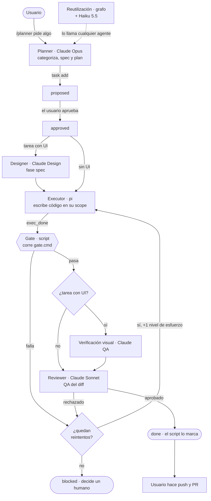

# software-engineer (harness-core)

Orquestador determinista (sin LLM) para trabajar con agentes de código: guarda el estado de cada tarea, la clasifica (categoría + tier de riesgo), decide qué modelo y esfuerzo usa cada rol, corre el gate de verificación y mide el gasto.

**Reparto de roles** (el de fábrica; cada rol se puede mover a otro runner y modelo, ver [Runners y modelos](#runners-y-modelos))

| Rol | Corre en | Qué hace |
|---|---|---|
| `planner` | Claude (Opus) | Habla contigo, escribe spec y plan, orquesta al resto |
| `executor` | pi ([pi.dev](https://pi.dev), headless) | Escribe el código dentro del scope aprobado |
| `reviewer` | Claude (Sonnet) | QA y revisión visual |
| `designer` | Claude (Sonnet) + Claude Design | Diseño de UI |
| `explore` | Grafo + Haiku 5.5 | ¿Ya existe algo reutilizable? (`harness explore`, `harness reuse-check`); cualquier agente lo llama |

El gate lo corre el script; ningún agente marca una tarea como `done`.

## Cómo se comportan los agentes

Ciclo de vida de una tarea (`harness next <id>` devuelve el siguiente paso según el estado):



Quién decide qué:
- **El script** (`harness`) manda: calcula el siguiente paso, el modelo y el esfuerzo, corre el gate y marca `done`. Los agentes no se auto-aprueban.
- **El planner** solo planifica y lanza lo que `harness next` indica; no escribe código ni reemplaza a un agente caído.
- **Si pi falla**, el script reintenta una vez con más esfuerzo y luego pasa la tarea a `blocked`. Cambiar el executor a Claude es una decisión humana.

## Requisitos
- node ≥ 20 y pnpm (`brew install pnpm`)
- Al menos un runner de IA: Claude Code, [pi](https://pi.dev), Codex, OpenCode o Antigravity (`agy`). Con la configuración de fábrica hacen falta Claude Code (planner, reviewer, designer) y pi (executor).
- [Herdr](https://herdr.dev) (`brew install herdr`), recomendado: abre un pane que sigue en vivo lo que hace pi. Sin él, `exec` imprime el progreso por stderr.
- pi (Node ≥ 22.19; `npm i -g --ignore-scripts @earendil-works/pi-coding-agent`) para lanzar el executor o el reviewer en headless. Cada proveedor de IA se conecta con `/login` dentro de pi (suscripción o API key); `pi --list-models` muestra los que ya tienes. Sus MCP (engram, codebase-memory) se declaran en `~/.pi/agent/mcp.json`.
- pi no tiene sandbox ni aprobaciones: el aislamiento es el scope del plan, las reglas del prompt y el gate.

`harness init` detecta qué falta y ofrece instalarlo (`harness doctor` lo muestra en cualquier momento).

## Instalación (una vez por máquina)
```bash
cd software-engineer
pnpm run setup                  # pnpm install + enlaces + comprobación
pnpm run setup -- --uninstall   # quita solo los dos enlaces
```
Crea `~/.claude/skills/harness` (comando `/harness` en Claude Code) y `~/.local/bin/harness` (comando `harness`). Es idempotente y no pisa enlaces ajenos. Asegúrate de que `~/.local/bin` esté en tu `PATH`.

## Actualizar
El CLI se instala desde un clon del repo, así que actualizar es traer los commits nuevos:
```bash
harness version                 # versión, commit y carpeta desde la que está instalado
harness upgrade --check         # ¿hay algo nuevo? lista los commits; no cambia nada
harness upgrade                 # git pull --ff-only + install.sh (dependencias y enlaces) + revisa tus proyectos
harness upgrade --sync          # igual, y además refresca los agentes de los proyectos desactualizados
harness fleet [--sync]          # solo la revisión de proyectos (agentes frente a las plantillas actuales)
```
`upgrade` se detiene sin tocar nada si el clon tiene cambios sin commitear o divergió del remoto. Los proyectos se buscan en `~/Projects`, `~/Lab` y `~/Servers` (cámbialo en `~/.harness/fleet.json`). Quien tenga una versión anterior a `upgrade` debe hacer `git pull` una vez en el clon.

## Guía de uso

### 1. Preparar un proyecto
Desde la raíz del proyecto:
```bash
harness init                 # dry-run: detecta stack, gate, rutas sensibles y qué runners tienes instalados
harness init --apply         # escribe lo propuesto y abre el asistente de runners y modelos
harness init --apply --yes   # sin preguntas: reparto recomendado
```
O dentro de Claude Code: `/harness init` (te muestra el plan y pregunta antes de escribir).

Genera `.harness/` (`profile.json`, `backlog.json`, `recommendations.md`), `AGENTS.md` y `.claude/agents/*.md`. No pisa nada existente sin `--force`. Revisa `.harness/profile.json`, sobre todo `gate.cmd` (tu comando de verificación) y `tiers.t2` (rutas críticas: migraciones, auth, billing, infra).

En una terminal, `init --apply` además:
1. ofrece instalar Herdr y pi si faltan (pide confirmación; no instala nada solo);
2. te deja elegir el **runner principal** (Enter = el reparto recomendado);
3. te deja asignar **runner y modelo por rol**, con los modelos de pi que ya tienes (Enter conserva el recomendado);
4. avisa si el reviewer es de la misma familia de modelo que el executor;
5. pregunta si guardar en **global** (todos tus proyectos) o solo en este proyecto.

Para repetirlo o cambiarlo después: `harness config`.

### Runners y modelos
Cada rol tiene un **runner** (`claude`, `pi`, `codex`, `opencode`, `antigravity`) y un **modelo**. Con pi el modelo se escribe `proveedor/id` (el de `pi --list-models`), y así un mismo runner sirve para varios proveedores. Ejemplo:

| Rol | Runner | Modelo |
|---|---|---|
| planner | `claude` | `claude-opus-5-5` |
| executor | `pi` | `openai/gpt-5.3-codex` |
| reviewer | `pi` | `google/gemini-2.5-pro` |

```bash
harness config                                          # asistente interactivo
harness config show                                     # configuración efectiva y de qué capa sale cada valor
harness config role executor pi openai/gpt-5.3-codex   # un rol, sin asistente
harness config role reviewer pi google/gemini-2.5-pro --global
harness config set main pi --global                     # runner principal: el de los roles sin asignar
```

**Capas** (la última gana): valores de fábrica → global `~/.config/harness/config.json` → proyecto `.harness/profile.json`. `--global` escribe en el global; sin él, en el proyecto. `main` solo reasigna `planner`, `executor` y `reviewer` que nadie fijó; `designer` (Claude Design) y `explore` (Haiku) se quedan en Claude salvo que los asignes.

**Quien revisa no es quien escribió:** el reviewer no puede ser de la misma familia de modelo que el executor (openai, google, anthropic…). Se compara la familia del modelo, no el runner: pi con Codex y pi con Gemini sí son distintos. Si coinciden, el planner se detiene y avisa.

**Qué lanza `harness exec`:** `pi`, `codex` (`codex exec`), `opencode` (`opencode run`) y `antigravity` (`agy --print`), como `executor` o `reviewer` (`harness exec <id> --role reviewer`). `claude` corre como subagente que lanza el planner. Ningún runner tiene sandbox: escriben código directamente en el repo, y el aislamiento es el scope del plan, las reglas del prompt y el gate.
- **codex:** el executor corre con `-s danger-full-access` (`codex.execSandbox`; el sandbox de Codex bloquea `.git` y no podría commitear). El reviewer corre con `workspace-write` (`codex.reviewSandbox`): ejecuta el gate pero no puede commitear. Por tier: `codex.byTier.T2.sandbox`.
- **opencode:** corre con `--auto` (aprueba permisos). El esfuerzo no se pasa, porque `--variant` depende del proveedor. El modelo se valida contra `opencode models`.
- **antigravity** (`agy`, `brew install --cask antigravity-cli`, abre `agy` una vez para iniciar sesión): usa tu cuenta Google y ofrece Gemini, Claude y GPT-OSS (`agy models`). Corre con `--dangerously-skip-permissions`. Si el id del modelo ya trae el esfuerzo (`gemini-3.8-flash-high`) no se pasa `--effort`. Es la vía para Gemini con suscripción; en pi, Gemini requiere `GEMINI_API_KEY`.
- **codex, opencode y antigravity** no tienen bandera de system prompt: el prompt de la tarea les pide leer `.harness/prompts/<rol>.md` primero. El costo de Codex sale de la tarifa del modelo en `PRICES`; si no la tiene queda en 0 y el informe lo avisa.
- Binarios: `PI_BIN`, `CODEX_BIN`, `OPENCODE_BIN`, `AGY_BIN` o `pi.bin` / `codex.bin` / `opencode.bin` / `antigravity.bin` en el perfil.
- El asistente (`harness config`) muestra los modelos de cada runner: los pide a `pi --list-models`, `opencode models` y `agy models`; para claude y codex sugiere los conocidos.

### 2. Trabajar una tarea
En Claude Code, en el proyecto:
```
/planner agrega login con Google
```
El planner categoriza, escribe el plan, registra la tarea y te pide aprobación. Luego lanza executor → reviewer → gate. Tú solo apruebas y haces el push al final (el harness nunca hace push ni merge).

### 3. Hacerlo a mano (CLI)
```bash
harness task add T1 --title "Login con Google" --category feature --paths 'src/auth/**'
harness task approve T1
harness next T1                       # siguiente paso: rol, modelo, esfuerzo
harness exec T1 --instruction "..."   # executor en pi (headless)
harness exec T1 --role reviewer       # reviewer en pi, si su runner es pi
harness explore --reindex                                                 # una vez por repo: indexa el grafo en modo full
harness explore "formatear montos en pesos"                               # antes de escribir: ¿ya existe algo?
harness explore "formatear montos en pesos" --deep                        # el código usa otros nombres: Haiku decide reuse/extend/new (se guarda en caché)
harness reuse-check --strict                                              # después de escribir: ¿el diff duplica código? (código 1 si sí)
harness gate T1                       # corre el gate y mueve el estado
```
Categorías: `feature fix hotfix refactor perf docs test infrastructure chore release` (`harness categories`). El tier es T0/T1/T2 y gana el más alto entre la categoría y las rutas tocadas (`harness classify <cat> --paths a,b`).

### 4. Configuración y métricas
```bash
harness config show                             # runners y modelos efectivos (ver «Runners y modelos»)
harness config get models.designer.model
harness config set models.executor.model <proveedor/id> [--global]
harness agents sync                             # regenera el bloque de proyecto de cada agente tras editar el perfil
harness metrics collect                         # métricas en .harness/metrics/*.toon
harness metrics report [T1]                     # informe legible: gasto por rol, intentos, cuota
harness doctor                                  # comprueba el entorno
```
Todo comando acepta `--root DIR` para apuntar a otro proyecto.

## Estructura
```
bin/harness.mjs      CLI
src/classify.mjs     categoría + tier            src/tasks.mjs    máquina de estados
src/router.mjs       modelo/esfuerzo por rol     src/gate.mjs     gate + scope manifest
src/pi.mjs           pi (headless)               src/metrics.mjs  métricas TOON
src/config.mjs       runners, familias, capas    src/wizard.mjs   asistente de config
src/runners.mjs      lanzadores pi/codex/opencode/antigravity
src/upgrade.mjs      version, upgrade, fleet
src/init.mjs         detección del proyecto      src/defaults.mjs perfil y precios por defecto
agents/*.md          prompts de cada rol         skill/SKILL.md   comando /harness
test/                node --test
```

## Desarrollo
```bash
pnpm test
```

## Notas
- Los prompts están en inglés por eficiencia de tokens; los agentes responden en tu idioma.
- Los costos en `src/defaults.mjs` (`PRICES`): la escritura de caché y la lectura de Haiku son supuestos.
- Si pi no está disponible, el executor no cae a Claude: el planner se detiene y avisa.
